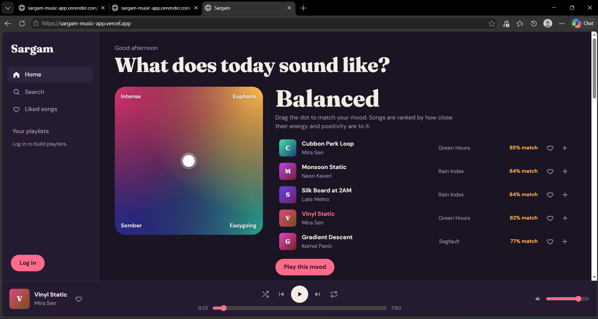

# Sargam: full-stack music streaming app

A Spotify-style web app built with the MERN stack. Its standout feature is a **mood pad**: drag a dot between calm and intense, somber and happy, and the app recommends songs whose audio features sit closest to that point.

**Live demo:** _add your Vercel link_ · **API:** _add your Render link_
**Demo login:** `demo@sargam.dev` / `demo1234`



## Features
- Persistent player: play/pause, seek, volume, next/previous, shuffle, repeat, keyboard shortcuts (Space, Shift+←/→) and OS media-key support
- Browse trending and all songs; debounced search with genre filters
- JWT authentication (bcrypt-hashed passwords), liked songs, full playlist CRUD
- **Recommendations** (see below): mood pad, "More like this", and "Made for you"
- Responsive layout, keyboard-accessible controls, generated cover art (no image hosting needed)

## Tech stack
React 18 + Vite + React Router · Node.js + Express · MongoDB + Mongoose · JWT · HTML5 Audio + Media Session API

## How the recommender works
Each song stores a feature vector: `energy, valence, danceability, acousticness, tempo` (all 0 to 1).
- **More like this:** rank all songs by Euclidean distance to the current song's vector.
- **Mood pad:** the pad's (x, y) is a point in the (valence, energy) plane; songs are ranked by distance to it.
- **Made for you:** average the vectors of liked and recently played songs into a taste profile, then recommend the nearest songs the user hasn't heard.

Match % = `1 - distance / max possible distance`. The code is in `server/src/utils/recommend.js`.
Planned upgrade: replace hand-entered features with ones extracted from audio (e.g. librosa) and compare against k-NN / cosine variants.

## API
| Method | Route | Auth | Purpose |
|---|---|---|---|
| POST | `/api/auth/register`, `/api/auth/login` | – | Create account / log in |
| GET | `/api/auth/me` | ✔ | Current user |
| GET | `/api/songs?q=&genre=&page=&limit=` | – | Browse and search |
| GET | `/api/songs/trending`, `/genres` | – | Trending list, genre list |
| GET | `/api/songs/mood?energy=&valence=` | – | Songs nearest a mood |
| GET | `/api/songs/:id/similar` | – | Similar songs |
| POST | `/api/songs/:id/play` | optional | Count a play, save to history |
| GET / PUT | `/api/me/liked`, `/api/me/liked/:songId` | ✔ | List / toggle likes |
| GET | `/api/me/recent`, `/api/me/for-you` | ✔ | History, personalised picks |
| GET / POST | `/api/playlists` | ✔ | List / create |
| GET / PATCH / DELETE | `/api/playlists/:id` | ✔ | Read / rename / delete |
| POST / DELETE | `/api/playlists/:id/songs[/:songId]` | ✔ | Add / remove a song |

## Run locally
```bash
docker compose up -d                 # MongoDB (or use a free Atlas cluster)

cd server
cp .env.example .env                 # set JWT_SECRET
npm install
npm run seed                         # loads sample songs + demo user
npm run dev                          # http://localhost:5000

cd ../client
npm install
npm run dev                          # http://localhost:5173
```

## Using your own music
Edit the `rows` list in `server/src/seed.js`: change titles, artists and `audioUrl` (any direct MP3 link, or files you host), then run `npm run seed` again.

## Deploy
- **Database:** MongoDB Atlas free tier → copy the connection string
- **API:** Render web service, root `server`, build `npm install`, start `npm start`, env `MONGO_URI`, `JWT_SECRET`, `CLIENT_URL` (your Vercel URL)
- **Client:** Vercel, root `client`, env `VITE_API_URL=https://<your-api>.onrender.com/api`
- Run `npm run seed` once against the Atlas database

## Roadmap
Audio-feature extraction with librosa · queue editing · listening-history charts · tests (Jest + Supertest)
